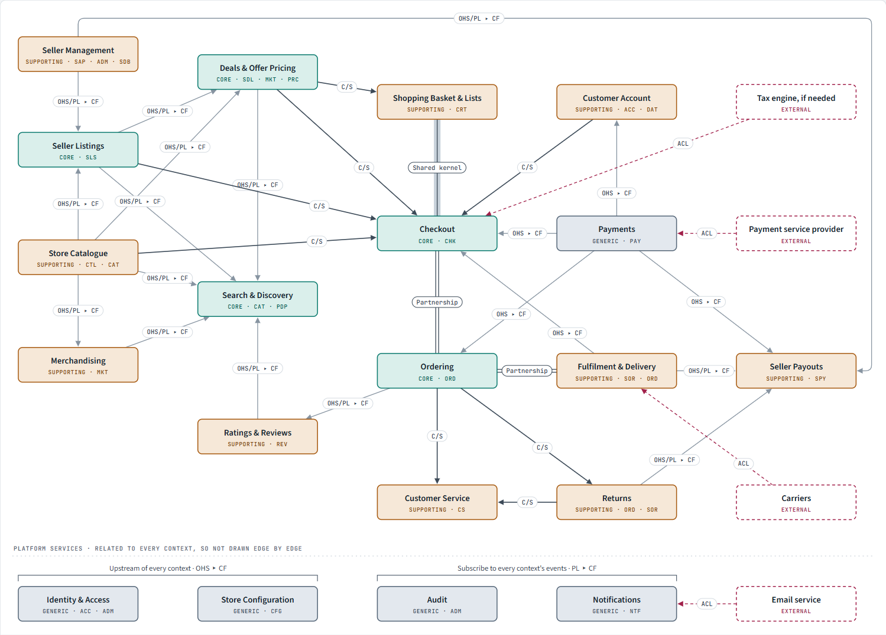

# Experiment 1.1: Getting bounded contexts from a BRD

[Back to all experiments](../../README.md)

## Goal

Find out whether an AI can do **strategic DDD** from a business requirements document alone: identify the bounded contexts, classify each as core, supporting or generic, and work out how the contexts relate to one another, with every decision traced back to the BRD.

## Input

[HexCommerce_Business_Requirements_Document_v3.0.docx](HexCommerce_Business_Requirements_Document_v3.0.docx) describes HexCommerce, an online store that also sells approved third-party sellers' products as a marketplace. It covers:

- user roles, a capability map and status lifecycles
- 31 business processes (P01 to P31)
- 317 functional requirements and 111 business rules
- entities, integration points and business objectives (BO-01 to BO-11)

## Output

| File | Description |
| --- | --- |
| [HexCommerce Context Map.html](HexCommerce%20Context%20Map.html) | Interactive context map. Select a context to trace its relationships, or highlight a relationship pattern. Open it in a browser. |
| [HexCommerce Context Map.md](HexCommerce%20Context%20Map.md) | The same content as Markdown. |

## Results

The BRD resolves into **20 bounded contexts** and **4 external systems**, linked by **45 relationships**.

Arrows run from upstream to downstream; each is labelled with its relationship pattern. External systems are shown dashed. The platform services at the bottom relate to every context and are not drawn edge by edge. Open the [interactive version](HexCommerce%20Context%20Map.html) to trace a single context's relationships.

**Core (5)**: where HexCommerce competes; build in-house and model richly.

| Context | Responsibility |
| --- | --- |
| Search & Discovery | Help shoppers find the right item across the catalogue and seller listings |
| Deals & Offer Pricing | Decide each item's current price and the units offered at that price |
| Checkout | Turn a basket into a paid order without losing the sale or overselling |
| Ordering | Hold the order of record from placement to delivery, cancellation and refund |
| Seller Listings | Put approved sellers' products on sale alongside the store's own |

**Supporting (10)**: specific to the business but not a differentiator; build simply.

Store Catalogue, Merchandising, Shopping Basket & Lists, Customer Account, Fulfilment & Delivery, Returns, Customer Service, Ratings & Reviews, Seller Management, Seller Payouts.

**Generic (5)**: problems every business has; buy or adopt and conform.

Identity & Access, Payments, Notifications, Audit, Store Configuration.

**External systems (4)**: payment service provider, carriers, email service, and a tax engine if needed. Each is reached through an anti-corruption layer.

For each context the map records its purpose, the aggregates and rules it owns (with BRD identifiers), its ubiquitous language, and why it is classified the way it is.

## Relationship patterns used

| Pattern | Where it appears |
| --- | --- |
| Open host service / published language ▸ conformist | Catalogue, Listings, Deals and others publishing to Search, Payouts, Notifications, Audit |
| Customer–supplier | Account, Deals, Catalogue and Listings supplying Checkout; Ordering supplying Returns and Customer Service |
| Partnership | Checkout ⇄ Ordering, Ordering ⇄ Fulfilment & Delivery |
| Shared kernel | Shopping Basket & Lists ⇄ Checkout (totals and limits) |
| Anti-corruption layer | Every external system |
| Separate ways | Ratings & Reviews ✕ Seller Listings (reviews cover catalogue products only) |

The full register of all 45 relationships, with what crosses each boundary and the BRD references, is in the context map.

## Evidence for the boundaries

The boundaries follow changes in the language, ownership or consistency rules in the BRD. The context map lists the terms whose meaning shifts across a boundary, for example:

- **Order**: the shopper's order in Ordering, but a per-seller *seller order* showing only buyer name and city in Fulfilment & Delivery.
- **Stock**: *units in stock* in Catalogue and Listings, *units available* (capped by deal units left) in Deals, Basket and Checkout, and a *stock status* band in Search.
- **Seller**: an applicant in Seller Management, a dispatching party in Fulfilment and Returns, a payee in Seller Payouts.
- **Refund**: an amount due in Ordering, a money movement in Payments, a deduction in Seller Payouts.

## Design notes from the experiment

- **Order placement crosses five contexts.** Run it as a saga owned by Checkout (reserve stock and deal units, authorise payment, then Ordering commits and publishes `OrderPlaced` through a transactional outbox).
- **Ordering owns order status.** Fulfilment reports dispatch and carrier events; Ordering derives status from its lines.
- **Seller approval is a broadcast** to every seller-facing context.
- **Compositions are not contexts.** Product detail, seller overview and agent views gather data from several contexts; storefront, seller tools and back office are channels.
- **No Inventory context.** Listing status and stock form one invariant and warehouse management is out of scope.
- **Open questions that could move a boundary:** Q-03 (tax engine), Q-13 (reviews of listings), Q-37 (where moderation lives), Q-39 (who handles seller returns).

## Observations

- The AI traced each context, aggregate and relationship to specific BRD identifiers (BO, P, FR, BR, NFR, Q), which makes the output reviewable against the source.
- It separated upstream/downstream (whose model shapes whose) from the direction data flows.
- It surfaced the BRD's open questions that affect boundaries instead of silently deciding them.
- The result is a starting point for review by domain experts and engineering, not a final design.
